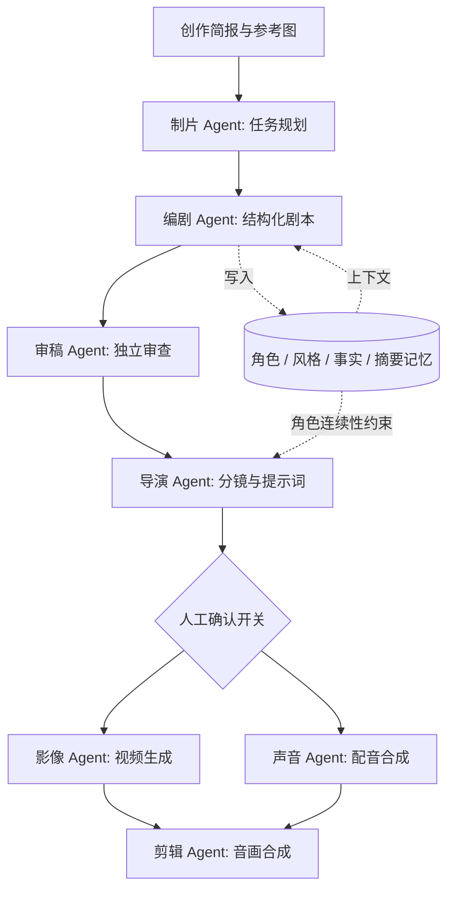

# FrameFlow · AI 短剧 Agent 设计与编排

[](LICENSE)

一套可运行的短剧创作工作台与多 Agent 工程原型。围绕「创作简报 → 剧本 → 分镜 → 视频与配音 → 音画合成」组织创作，交付界面、编排引擎、真实工具适配、自动化测试与项目展示文档。

## 立即体验

- 公开架构首页（无需登录）：<https://wanyuezhang-ai.github.io/frameflow-ai-drama/>
- 网页填写自己的 API：<https://wanyuezhang-ai.github.io/frameflow-ai-drama/studio.html#connect>
- 无密钥交互演示：<https://wanyuezhang-ai.github.io/frameflow-ai-drama/studio.html?mode=demo>
- 开源维护者：[WanyueZhang-ai](https://github.com/WanyueZhang-ai)。
- 本地：安装 Node.js 22+，在本目录运行 `npm start`，打开 <http://127.0.0.1:8787>。
- 无第三方运行依赖，无需安装前端包。演示模式不需要 API Key。
- 执行 `npm test` 运行编排与适配器测试；`npm run check` 检查语法和静态资产。

## 已实现的能力

| 模块 | 实现 |
| --- | --- |
| 创作工作台 | 多项目、简报编辑、类型/画幅/时长/风格、参考图、结构化剧本编辑、镜头编辑 |
| 任务编排 | 7 节点依赖图、并行分支、状态机、人工确认、停止与恢复、检查点 |
| 工具调用 | LLM / MLLM、视频适配器、TTS、浏览器媒体工具 / FFmpeg；校验、限时与瞬时错误重试 |
| 协作与记忆 | 可视化场景布局、角色与风格编辑、状态时间线、版本来源、跨 Agent 上下文传递 |
| 场景补全 | 4 个可视模板、逐项选择背景、三种补全策略、角色站位与场景参考图；选择写入实际生成提示词 |
| 可观测性 | 阶段状态、实际耗时、调用/重试事件、外部视频任务 ID、JSON 导出 |
| 交付 | 动态分镜演示、剧本文本、分镜 JSON、SRT、浏览器 MP4 / WebM、服务端 MP4 |

## 可视化记忆与场景补全

打开 [场景工作台](https://wanyuezhang-ai.github.io/frameflow-ai-drama/studio.html?mode=demo#memory)，在「项目记忆」中选择场景模板、勾选元素、调整位置和机位，再点击「保存并用于生成」。修改先保留为草稿；保存会保留剧本与审稿，重置分镜和后续媒体。可以查看实际生成约束、编辑角色外观与风格，以及查看场景起止状态和设定变更。刷新、重新运行、切换生成模式时会保留已保存的设定。

布局为俯视创作示意，通过提示词传递；每场可选参考图作为图片条件传递。当前没有三维重建、自动画面质量验收或跨镜头一致性保证。详见 [记忆模块说明](docs/MEMORY.md)。

## 三种运行方式

**演示模式**真实执行编排代码，创作工具为明确标注的规则模板；6 个镜头使用同一张 AI 概念图裁切与缩放。浏览器语音不是 TTS 音频文件，动态分镜不是视频模型成片。自定义故事在演示中只获得模板式结构，不保证创意遵从性。所有日志来自当前执行；初始示例明确标为预制样例，不伪造模型指标。

**网页直连模式**在工作台选择「网页直连 · 使用自己的 API」，填写三个服务的 HTTPS 地址、模型与 Key。浏览器直接调用兼容 Chat Completions 的语言/视觉模型、符合本项目 `/jobs` 协议的视频服务，以及 Speech-compatible 配音服务。接口与视频文件需允许网页来源的 CORS 请求。Key 仅保留在当前标签页内存，不写入 localStorage、项目 JSON 或 GitHub；各 Key 仅发送到对应的配置地址。使用你信任的 API 服务，费用由服务商结算。

生成的视频与 TTS 在浏览器内实时合成，支持时输出 MP4，否则 WebM。合成时保持页面前台。配音与成片为本页 Blob，刷新后失效；文字产物与视频任务 ID 可恢复，需重新输入 Key 并重新配音、合成。模型调用未使用付费凭据进行质量验收；浏览器 MP4 合成已用本地生成的画面与声音实测通过。

**个人服务端模式**使用本地 Node 服务端，密钥仅保存在环境变量。复制 `.env.example` 为 `.env`，配置 LLM、视觉模型能力、Speech TTS、视频适配器，并安装 FFmpeg。在本地打开 `/studio.html` 选择「个人服务端」后生成 MP4。详见 [PROVIDERS.md](docs/PROVIDERS.md)。

## 工程结构

```text
frameflow/
├── dist/                    在线展示与本地前端
│   ├── index.html / portal.*  无需登录的公开架构页
│   ├── studio.html / style.css / app.mjs  创作工作台
│   ├── connect.mjs            网页 API 配置，Key 仅在内存
│   ├── lib/browser-*.mjs      API 直连与浏览器音画合成
│   ├── lib/model.mjs          共用 LLM / MLLM 协议
│   ├── lib/engine.mjs        浏览器与服务端共用编排引擎
│   ├── lib/demo.mjs          可运行演示工具
│   └── assets/              概念图与图标
├── src/providers.mjs        LLM、视频、TTS、合成适配
├── server.mjs               本地 HTTP API、检查点、媒体下载
├── tests/                   调度行为与工具协议测试
├── scripts/check.mjs        静态检查
├── docs/PROJECT.md          项目方案与展示讲解
├── docs/PROVIDERS.md        配置与接口协议
├── docs/ASSETS.md           视觉资产来源及提示词
├── .env.example             环境变量模板
└── data/                    运行后生成，本地状态与媒体，不入库
```

## 流程



## 持久化与恢复

- 演示：浏览器 `localStorage` 按项目保存简报、记忆、产物与事件；刷新后停止未完成演示，保留检查点。
- 网页直连：API Key 仅保留在标签页内存；文字产物与视频任务检查点可恢复，配音与合成 Blob 刷新后需要重新生成。
- 真实：`data/runs/<id>.json` 原子替换保存；媒体位于 `data/media/<id>/`；服务重启后把未完成任务标为可恢复。
- 视频任务 ID 与完成结果持久化，重试优先继续轮询；视频适配器必须落实 `Idempotency-Key`，以降低重复提交风险。
- 编辑剧本会使审稿及其下游失效；编辑镜头使视频、配音、合成失效。已完成的无关分支可以复用。
- 审稿不通过会停止流程，用户编辑剧本后重新审稿。模型格式不合法会定向修复一次；网络、429 和部分 5xx 最多尝试三次。

## 原型边界

这是一套适合个人演示、作品集和工程扩展的单用户原型。在线可阅读架构、运行演示，或自带 API 真实生成；GitHub Pages 仅提供前端，不保存或代理用户密钥。个人服务端为可选方式。视频服务需符合项目协议；没有宣称兼容所有供应商原生接口。

当前配音按镜头合成，默认统一音色；人物声线是记忆与扩展字段，尚未实现逐角色音色路由。音画合成对每镜头音轨补静音或按时长截断，过长台词可能被截断；字幕单独导出，未烧录。没有音素级对齐、口型同步、向量检索或实际跨镜头身份保证。

生产化还需用户鉴权与隔离、任务队列、集中数据库/对象存储、费用限额、回调验签、完善的出站媒体网络策略、媒体时长探测与配音加速对齐、长期记忆检索和真实模型质量评估。不要直接将当前本地服务暴露到公网。

## 官方接口参考

- [Chat Completions](https://developers.openai.com/api/reference/resources/chat/subresources/completions/methods/create)
- [Speech](https://developers.openai.com/api/reference/resources/audio/subresources/speech/methods/create)
- [FFmpeg](https://ffmpeg.org/ffmpeg.html)

模型可用性由供应商决定，以服务端配置为准。


## 开源与发布

代码使用 [MIT 许可证](LICENSE)。本开源版本已移除原站点部署身份和运行数据；视觉素材来源见 [ASSETS.md](docs/ASSETS.md)。欢迎提交 Issue 或 Pull Request，开发流程见 [CONTRIBUTING.md](CONTRIBUTING.md)。

仓库提供测试与 GitHub Pages 工作流；首次启用方法见 [PUBLISHING.md](docs/PUBLISHING.md)。GitHub Pages 托管架构页、演示与自带 API 前端，不承载模型服务。
